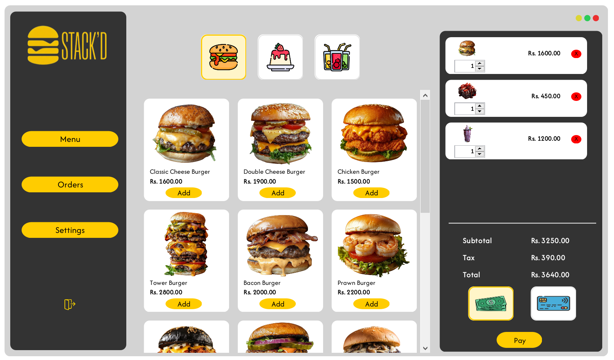
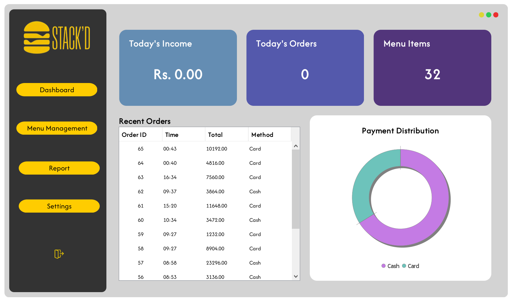
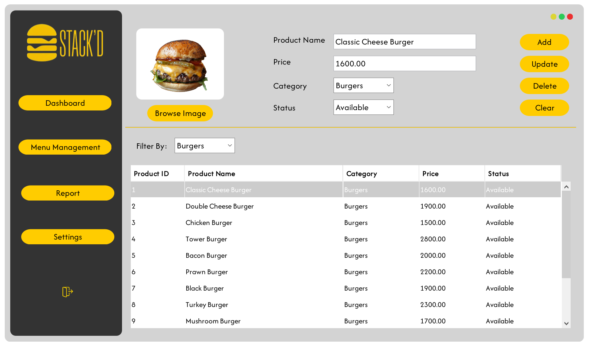

# SmartDine | Restaurant Management & POS System

SmartDine is a tailored Java Swing desktop solution designed to automate restaurant operations, billing, menu management, and sales reporting. Built to replace manual order tracking, this system provides cashiers and administrators with a modern, responsive interface backed by a relational MySQL database.

## Tech Stack

- **Language & Framework:** Java (Java Swing, FlatLaf, MigLayout)
- **Database:** MySQL
- **Security:** BCrypt Password Hashing (`jBCrypt`)
- **Reporting & Charts:** JFreeChart, iTextPDF
- **IDE:** NetBeans / IntelliJ IDEA / Eclipse

## Core Features

- **Interactive POS & Billing:** Real-time cashier terminal to browse categorized menu items, customize orders, calculate totals, handle cash/card payments, and generate itemized receipts.
- **Menu & Product Management:** Dedicated admin controls to add, update, remove, and toggle availability of food/drink items along with image previews and unit pricing.
- **Sales Analytics & Reports:** Live dashboard tracking daily revenue, total order count, payment method breakdown (Cash vs. Card), and date-filtered sales reports.
- **Role-Based Authentication:** Secure access control distinguishing between Admin and Cashier roles with encrypted passwords.
- **Customizable Store Settings:** Configure restaurant branding, contact numbers, address, and receipt footer notes dynamically.

## Screenshots

**Login Screen**  


**Cashier POS & Ordering Screen**  


**Admin Dashboard & Analytics**  


**Menu & Product Management**  


## Getting Started

Follow these instructions to set up and run the project locally on your machine.

### Prerequisites

- Java Development Kit (JDK 8 or higher, JDK 17/21 recommended)
- MySQL Server 8.0 (or XAMPP with MySQL)
- NetBeans IDE, IntelliJ IDEA, or Eclipse

### Installation & Setup

1. **Clone the repository:**
   ```bash
   git clone https://github.com/AsfaThahani/SmartDine.git
   ```

2. **Database Setup:**
   * Open MySQL Workbench or phpMyAdmin.
   * Create a database named `smartdine` (if not already created):
     ```sql
     CREATE DATABASE smartdine;
     ```
   * Execute the provided database script (`schema.sql`) to generate the tables and relations.

3. **Configuration:**
   * Open the project in your IDE.
   * Open `src/db/DBconnection.java`.
   * Update the connection credentials to match your local MySQL configuration:
     ```java
     private static final String URL = "jdbc:mysql://localhost:3306/smartdine";
     private static final String USER = "root";
     private static final String PASSWORD = "YOUR_MYSQL_PASSWORD";
     ```

### Running the Application

1. Open the project in NetBeans or your preferred IDE.
2. Ensure the required `.jar` dependencies in the project root and `lib/` directory (`mysql-connector-j`, `jbcrypt`, `miglayout`, `itextpdf`, `jfreechart`) are included in your project libraries.
3. Clean and build the project (Shift + F11 in NetBeans).
4. Run the project (F6 in NetBeans) or run the compiled JAR:
   ```bash
   java -jar dist/SmartDine.jar
   ```
